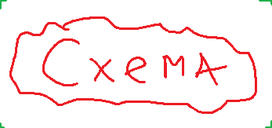

---
# ─────────────────────────────────────────────────────────────────────────
# Per-document metadata. Everything institution-wide (fonts, margins,
# headings, labels) lives in profiles/sibfu/profile.toml — this file only
# selects a profile and provides values for THIS document.
#
# Private values (student names, etc.) live in the environment:
#   SUPERVISOR_NAME, STUDENT_NAME
# A `.env` next to this file (or in CWD) is loaded automatically.
# ─────────────────────────────────────────────────────────────────────────
project:
  profile: sibfu # plain name → searched in ./profiles, <md_dir>/profiles, etc.
  doc_type: course_work # selects title template from profile.toml's [doc_types]

title:
  institute: "Институт космических и информационных технологий"
  department: "Кафедра систем искусственного интеллекта"
  topic: "Разработка конвертера Markdown в LaTeX"
  supervisor: "${SUPERVISOR_NAME:-П. П. Петров}"
  year: "2026"
  city: "Красноярск"
  students:
    - group: "ПИ21-01Б"
      student_id: "987654321"
    - name: "${STUDENT_NAME:-И. И. Ветров}"
---

# ВВЕДЕНИЕ

Курсовая работа посвящена разработке конвертера, который преобразует
документы, написанные в Markdown, в LaTeX-файлы и итоговые PDF-документы
с оформлением по требованиям СТУ 7.5-07.

## Актуальность

Оформление учебных текстов в офисных редакторах отнимает время и приводит
к ошибкам: сбиваются отступы, нумерация рисунков, шрифты. Использование
Markdown для содержания и автоматической генерации LaTeX для типографики
позволяет студенту сосредоточиться на тексте, а не на оформлении.

## Постановка задачи

Требуется разработать конвертер, который принимает на вход Markdown-файл
и формирует LaTeX-документ, оформленный в соответствии со стандартом
СТУ 7.5-07. Конвертер должен поддерживать изображения, таблицы, списки
и формулы, а также автоматически генерировать титульный лист и содержание.

# ОСНОВНАЯ ЧАСТЬ

## 1 ПОСТАНОВКА ЗАДАЧИ

### 1.1 Цель работы

Цель работы — разработать конвертер, преобразующий Markdown-документ
в LaTeX-файл с _оформлением_, ~~соответствующим~~ **СТУ 7.5-07**.

### 1.2 Задачи

- изучить синтаксис Markdown и структуру LaTeX-документа, включая:
  - таблицы и их выравнивание ооооооооооооочень длинная строка тут должна быть для тестов;
  - изображения и подписи к ним;
  - формулы и их нумерацию;
  - сноски и перекрёстные ссылки;
- спроектировать архитектуру конвертера, для чего необходимо:
  1. определить границы ответственности модулей;
  2. продумать систему конфигурации ооооооооооооочень длинная строка тут должна быть для тестов;
  3. выбрать инструменты для парсинга и генерации;
- реализовать модули разбора и генерации;
- оформить титульный лист, содержание и разделы автоматически;
- проверить работоспособность на тестовом примере.

## 2 ПРОЕКТИРОВАНИЕ

### 2.1 Архитектура

Конвертер состоит из нескольких модулей. Схема работы приведена на рисунке `\ref{fig:scheme}`.



Программа выполняет три этапа: чтение Markdown, генерацию LaTeX и
компиляцию PDF. Как показано на рисунке `\ref{fig:scheme}`, каждый этап
реализован отдельным модулем.

### 2.2 Модули

Перечень модулей и их назначение приведены в таблице `\ref{tbl:modules}`.

#tbl:modules Перечень модулей и их назначение

| Модуль   | Назначение                        |
| -------- | --------------------------------- |
| config   | Чтение TOML-конфигурации          |
| markdown | Разбор Markdown и генерация LaTeX |
| images   | Копирование картинок              |

#tbl:long_list Длинный перечень данных

| Параметр                          | Значение                                |
| --------------------------------- | --------------------------------------- |
| Данные 1                          | H~2~O^3^                                |
| Данные 2                          | `H~2~O^3^`                              |
| Данные 3 вместе                   | <<                                      |
| Данные 4                          | 123                                     |
| Данные 2                          | 456                                     |
| ^^                                | 789                                     |
| Данные 1                          | 123                                     |
| Данные 2                          | 456                                     |
| Данные 3                          | 789                                     |
| Данные 1                          | 123                                     |
| Данные 2                          |  |
| Данные 3                          | 789                                     |
| Данные 1                          | 123                                     |
| Данные 2 двойная строка и столбец | <<                                      |
| ^^                                | <<                                      |
| Данные 1                          | 123                                     |
| Данные 2                          | 456                                     |
| Данные 3                          | 789                                     |
| Данные 1                          | 123                                     |
| Данные 2                          | 456                                     |
| Данные 3                          | 789                                     |
| Данные 1                          | 123                                     |
| Данные 2                          | 456                                     |
| Данные 3                          | 789                                     |
| Данные 1                          | 123                                     |
| Данные 2                          | 456                                     |
| Данные 3                          | 789                                     |
| Данные 1                          | 123                                     |
| Данные 2                          | 456                                     |
| Данные 3                          | 789                                     |
| Данные 1                          | 123                                     |
| Данные 2                          | 456                                     |
| Данные 3                          | 789                                     |
| Данные 1                          | 123                                     |
| Данные 2                          | 456                                     |
| Данные 3                          | 789                                     |
| Данные 1                          | 123                                     |
| Данные 2                          | 456                                     |
| Данные 3                          | 789                                     |
| Данные 1                          | 123                                     |


```cpp
int main() {
    std::cout << "TEST CODE" << std::endl;
    return 0;
}
```


## 3 РЕАЛИЗАЦИЯ

### 3.1 Парсер Markdown

Для разбора Markdown используется библиотека `comrak`. Она поддерживает
таблицы, изображения, формулы, списки и сноски — этого достаточно для
учебных документов.

### 3.2 Генерация LaTeX

Шаблон LaTeX формируется с помощью `tera`. Все стилевые параметры (шрифт,
поля, интервалы, положение подписей) хранятся в TOML-конфиге. Пример
запуска: `cargo run --release -- --config md2latex.toml`.

### 3.3 Сборка PDF

Итоговый PDF собирается через `xelatex`. Если в документе используются
`biblatex`-источники, дополнительно запускается `biber`.

### 3.4 Дополнительные возможности

Конвертер поддерживает сноски[^fn1], включая повторные ссылки[^fn1] на ту
же самую сноску — повторная ссылка получает тот же номер, но текст
печатается один раз.

[^fn1]: Текст сноски с _курсивом_ и **жирным** начертанием.

Формулы могут иметь метки для перекрёстных ссылок. Метка задаётся
отдельным параграфом `#eq:name` непосредственно перед `$$…$$`:

#eq:einstein

$$ E = mc^2 $$

Как показано в формуле `\ref{eq:einstein}`, энергия и масса связаны
соотношением Эйнштейна.

Листинги нумеруются и подписываются через `#lst:name` в info-string:

```cpp #lst:hello Пример программы на C++
#include <iostream>

int main() {
    std::cout << "Hello" << std::endl;
    return 0;
}
```

Ссылка на листинг: `\ref{lst:hello}`.

Выравнивание колонок в таблицах задаётся стандартным синтаксисом GFM
(`:---`, `:---:`, `---:`):

#tbl:align Выравнивание столбцов

| Слева    |   Центр    |  Справа |
| :------- | :--------: | ------: |
| строка 1 | значение 1 | число 1 |
| строка 2 | значение 2 | число 2 |

# ЗАКЛЮЧЕНИЕ

В ходе работы был разработан конвертер, который позволяет писать учебные
документы в Markdown и автоматически получать PDF с оформлением по
требованиям СТУ 7.5-07.

# СПИСОК ИСПОЛЬЗОВАННЫХ ИСТОЧНИКОВ

1. ГОСТ Р 2.105-2019. Единая система конструкторской документации. Общие требования к текстовым документам. – Москва : Стандартинформ, 2019. – 32 с.
2. СТУ 7.5-07-2021. Система менеджмента качества. Общие требования к построению, изложению и оформлению документов учебной деятельности. – Красноярск : СФУ, 2021. – 65 с.
3. Документация компилятора XeLaTeX. – URL: https://sourceforge.net (дата обращения: 12.11.2026).
