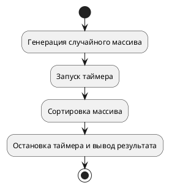

---
project:
  profile: sibfu
  doc_type: practice_work

title:
  institute: "Институт космических и информационных технологий"
  department: "Кафедра систем искусственного интеллекта"
  topic: "Исследование сложности алгоритмов сортировки"
  supervisor: "П. П. Петров"
  year: "2026"
  city: "Красноярск"
  students:
    - name: "И. И. Ветров"
      group: "ПИ21-01Б"
      student_id: "987654321"

extra:
  work_number: "1"
  discipline: "Алгоритмы и структуры данных"
---

# ОСНОВНАЯ ЧАСТЬ

## 1 ЦЕЛЬ И ЗАДАЧИ РАБОТЫ

Цель работы — изучить принципы работы алгоритмов быстрой сортировки и сортировки вставками, а также экспериментально оценить их временную сложность.

Задачи работы:
- реализовать алгоритмы на языке Python;
- провести замеры времени выполнения на массивах разного размера;
- сравнить теоретические и практические оценки.

## 2 ТЕОРЕТИЧЕСКИЕ СВЕДЕНИЯ

Асимптотическая сложность быстрой сортировки в среднем случае выражается формулой `\ref{eq:quicksort}`.

#eq:quicksort

$$ T(n) = O(n \log_2 n) $$

В худшем случае, при неудачном выборе опорного элемента, сложность возрастает до квадратичной O(n²).

## 3 ХОД РАБОТЫ

### 3.1 Реализация алгоритма

Исходный код функции быстрой сортировки представлен в листинге `\ref{lst:qsort}`.

```python #lst:qsort Реализация быстрой сортировки на Python
def quick_sort(arr):
    if len(arr) <= 1:
        return arr
    pivot = arr[len(arr) // 2]
    left = [x for x in arr if x < pivot]
    middle = [x for x in arr if x == pivot]
    right = [x for x in arr if x > pivot]
    return quick_sort(left) + middle + quick_sort(right)
```

Алгоритм работы программы проиллюстрирован на рисунке `\ref{fig:flow}`.



### 3.2 Результаты замеров

Результаты тестирования приведены в таблице `\ref{tbl:results}`.

#tbl:results Время выполнения алгоритмов сортировки

| Размер массива, эл. | Сортировка вставками, мс | Быстрая сортировка, мс |
| :-----------------: | -----------------------: | ---------------------: |
| 1 000               | 18,4                     | 1,2                    |
| 10 000              | 1 840,5                  | 15,8                   |
| 50 000              | 46 120,0                 | 92,4                   |

# ЗАКЛЮЧЕНИЕ

В ходе выполнения практической работы были реализованы и протестированы два алгоритма сортировки. Экспериментальные замеры из таблицы `\ref{tbl:results}` подтвердили, что быстрая сортировка значительно превосходит квадратичные алгоритмы на больших объёмах данных.

# СПИСОК ИСПОЛЬЗОВАННЫХ ИСТОЧНИКОВ

1. Кормен, Т. Х. Алгоритмы: построение и анализ / Т. Х. Кормен, Ч. И. Лейзерсон, Р. Л. Ривест, К. Штайн. – 3-е изд. – Москва : Вильямс, 2013. – 1328 с.
2. СТУ 7.5-07-2021. Система менеджмента качества. Общие требования к построению, изложению и оформлению документов учебной деятельности. – Красноярск : СФУ, 2021. – 65 с.
